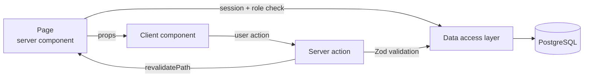

# Infusion – career development platform

> UCL MSc group project (COMP0067, January–April 2026). The repository is private
> to the module, so this page describes the system and the parts I built.

## What it is

A web app for career development. New users fill in an onboarding questionnaire,
which generates a personalised learning map. Around that sit job and informal
opportunity postings with applications, organisation profiles, events, mentoring,
an "Ask a question" Q&A answered by admins, to-dos and direct messages.

## Stack

- **App:** TypeScript, Next.js 16 (App Router), React 19, MUI
- **Data:** PostgreSQL 16, Prisma 7, Zod for validation
- **Auth:** NextAuth v5 with bcrypt
- **Infra:** Docker multi-stage build, Nginx reverse proxy with Let's Encrypt,
  Azure VM, Azure Blob Storage
- **Quality:** GitHub Actions (typecheck, ESLint, Prettier, build, unit tests and
  integration tests against Postgres), Jest, Playwright, k6

## How it's put together

The code is organised by feature, and dependencies only point one way:
`app → features → lib`.

- A page checks the session and the user's role, loads data through the data
  access layer and passes it to a client component
- When the user changes something, the client component calls a server action,
  which validates the input with Zod, writes through the data access layer and
  revalidates the page
- All Prisma queries live in the data access layer, and nothing else talks to
  the database

In production, Nginx terminates TLS and proxies to the Next.js container, which
talks to a Postgres container. A one-off migrator container applies database
migrations before the app starts.

## My part

- **Ask a question (Q&A)** – the pages for asking and viewing questions, the
  admin response page, and the schema changes behind them
- **Opportunities and applications** – a multi-step form for creating job and
  informal postings, managing applications as the poster, and a sent-applications
  page for applicants
- **Organisations** – list and detail pages with search and a verified-only
  filter, auth checks in the server actions, input length caps and URL validation
- **Workflow results** – replaced the mock data with real queries, fixed the
  columns and filters, and connected "Add to to-do list"
- **Refactor** – moved raw Prisma calls out of server actions and auth code into
  the data access layer, and added page-level auth checks
- **Deployment** – Docker setup, Nginx with TLS, production environment
  variables, a separate migrator stage, and redirecting raw-IP requests to
  the domain
- **Tooling** – the database seed script, Prettier setup, and k6 smoke and load
  tests (the load test ramps to 40 virtual users with a p95 target of 500 ms)

## Problems worth describing

**1. Running migrations from a standalone Next.js image.** Next.js standalone
output produces a small runtime image without the Prisma CLI, so
`prisma migrate deploy` couldn't run in production. Copying the Prisma engines,
the wasm file or parts of `node_modules` into the runtime image each broke in a
different way. The fix was to stop patching the runtime image and add a
dedicated migrator build stage with the full dependencies. It runs as a one-off
compose service that waits for Postgres to report healthy, then exits before the
app starts.

**2. Nginx kept a stale address for the app container.** `proxy_pass http://web:3000`
resolves the hostname once, when Nginx starts. If the app container came up
later or restarted with a new IP, requests failed. I pointed Nginx at Docker's
internal DNS resolver and used a variable upstream, so the name is resolved per
request.

**3. Duplicate applications from simultaneous requests.** Applying to an
opportunity checked whether an application existed and then inserted one. Two
requests arriving together could both pass the check. I replaced this with a
unique constraint on `(user_id, opportunity_id)` and handled Prisma's
unique-violation error, so the database enforces the rule. In the same round of
fixes I sanitised job-description HTML with DOMPurify to block XSS, limited
links to `http`/`https`, and fixed the optimistic UI so a failed status change
rolls back to the state just before that change rather than to the initial props.

---

[martinchaouk@gmail.com](mailto:martinchaouk@gmail.com) ·
[LinkedIn](https://www.linkedin.com/in/martin-chao-782348235/)
